# TrialTrace: Clinical Trial Evidence Intelligence Platform. Workflows

How data moves through TrialTrace: the registry side, the PubMed side, safety, and
the final combined picture. For the reasons behind each step see `DESIGN_DECISIONS.md`;
for one trial followed end to end see `HOW_IT_WORKS.md`.

## Current v1 storage and review workflow (2026-11-19)

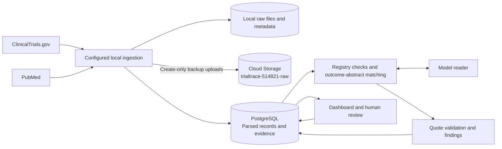

Ingestion writes locally before attempting the cloud backup. Registry and PubMed sources use the same `save_raw` adapter. The bucket stores source files and `.meta.json` at `raw/<source>/<NCT>/<hash>.<extension>`. Upload failures are logged per object while ingestion continues. Re-ingestion or an operator's create-only copy can reconcile missing objects.

The current hosted dashboard uses Cloud SQL for saved records and evidence. It has no runtime bucket read/write path. Local-file consumers can restore their source paths from the backup objects. Raw backup and local-to-cloud database synchronization are separate operations. Setup is in [DEPLOY_GCP.md](DEPLOY_GCP.md#raw-source-files-in-cloud-storage-added-2026-11-19).

## Historical combined workflow (2026-11-11)

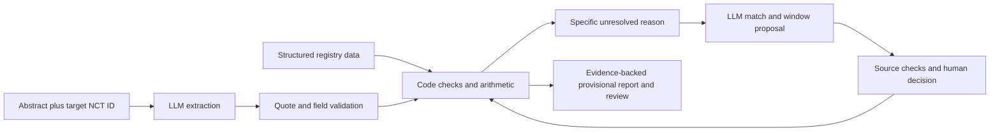

The code baseline is an optional diagnostic (`--with-baseline`) for both readers, not a prerequisite. A proposed
name match cannot override population, definition, denominator or collection-window requirements. Reports do not
make model calls. The outcome reader identifies the target trial explicitly and cache keys include that ID.

The unseen safety v2 draw (30 trials / 127 abstracts (123 strict unseen)) has labels for its first 30 trials (drafted by AI, reviewed by the owner, 2026-11-11) and 10 added trials still to label; nothing is frozen and no model has been run
on it. The registry wording audit found no candidate wording pairs, so no such helper is built. Historical workflow
milestones below retain their old evaluation context; current details are in `LLM_IMPROVEMENT_ITERATION.md`.

**Colours in every diagram**

| Colour | Meaning |
|---|---|
| Green | Built and tested |
| Amber | Next to build |
| Grey | Planned, later |
| Cylinder | Something saved (database table or file) |

**Three rules behind every arrow**

1. Unknown is unknown: a failure is recorded, never turned into "no".
2. Every claim cites evidence; a claim with no evidence is refused.
3. Differences are "for review", never a verdict.

---

## 1. Registry workflow (built)

### 1A. Getting one trial in (`python -m trialtrace ingest NCT...`)

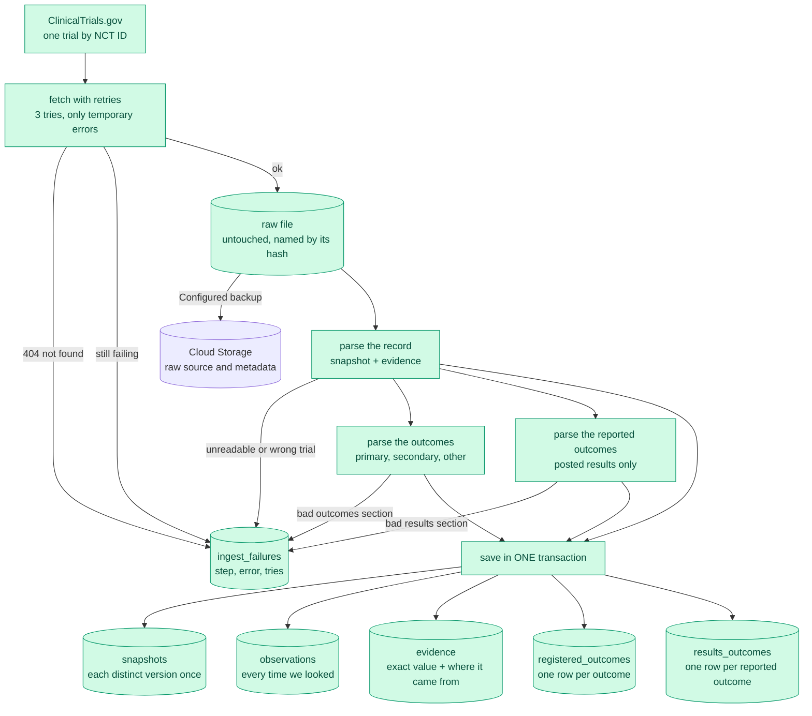

Key points
- The raw file is saved **before** parsing, so a parser bug never loses the original.
- A bad outcomes or results section is recorded, but the snapshot is still stored, with that part marked unknown.
- The same content seen again adds an observation, not a new snapshot (so `A -> B -> A` is kept in order).

### 1B. Answering questions 1 to 5a, then report and review

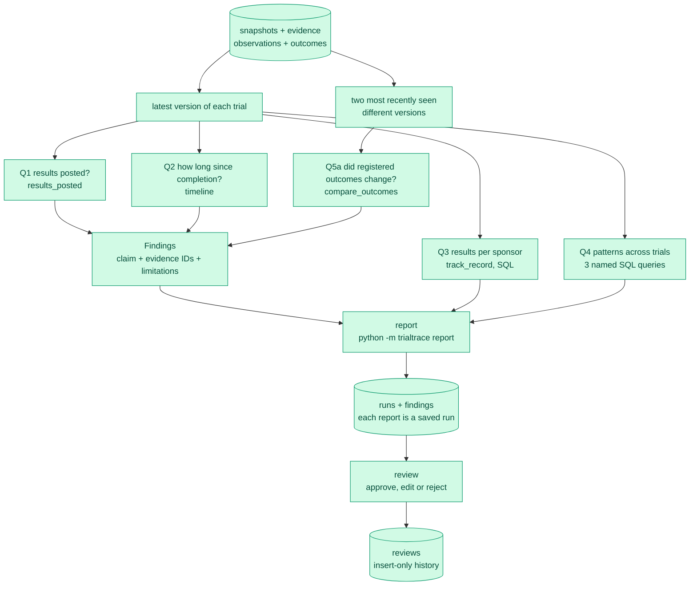

Key points
- Questions 3 and 4 are labelled "in the ingested corpus only".
- 5a never says "no change" when it has only one version or no outcomes: that is "unknown".
- A removed outcome next to an added one in the same role goes to **needs review**, not to "changed".
- By default review asks only about differences and items needing review (`--all` adds plain facts).

### 1C. Registered vs reported outcomes, results arm (built, in the report)

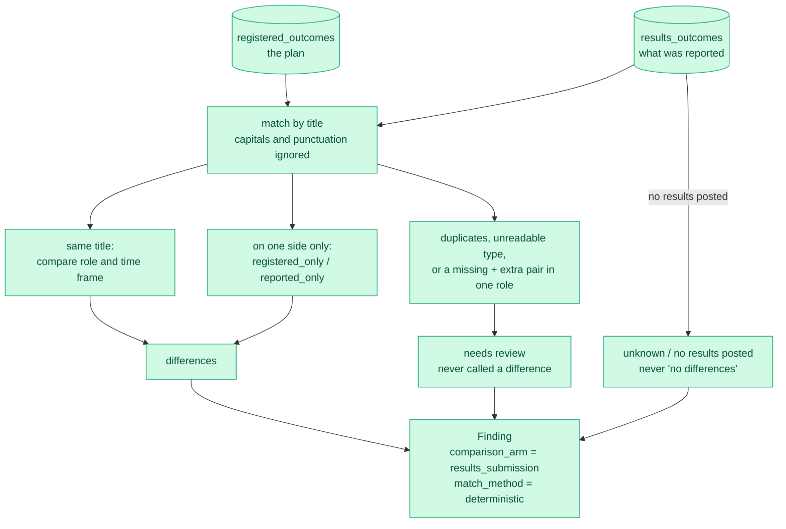

Key points
- Both sides are structured registry records, so no LLM is needed.
- Descriptions are not compared (results descriptions are usually longer).
- The registered list is from the same saved version, so this is not a comparison with the original plan.
- The finding is saved with its `comparison_arm` and `match_method`, shown in the report, and a match is never queued for review.

---

## 2. PubMed workflow

### 2A. Getting papers in (built: `python -m trialtrace ingest-papers`)

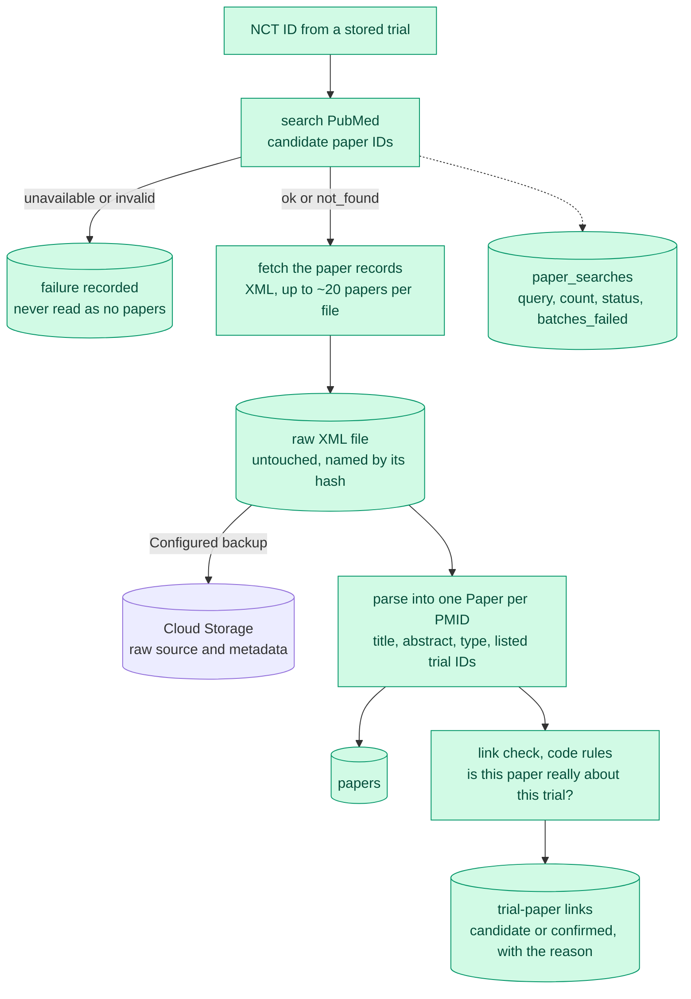

Key points
- A search hit is only a **candidate**. The link check grades it: `listed` (the paper's ID list names the trial), `text_only` (ID only in the title or abstract) or `not_confirmed`. All are stored with the reason.
- Request pacing: about 3 requests a second without a key, so we pause 0.4 s before each request and retry on 429.
- Every search is recorded. A search can be `ok` yet partial if a batch failed, so check `answered_fully`.
- One XML file holds many papers, so evidence and links are identified by **PMID** plus the file hash.
- We read the **abstract** only, so results will say "not identified in the available text (abstract)".

### 2B. Does the paper report the registered outcomes? (question 5b)

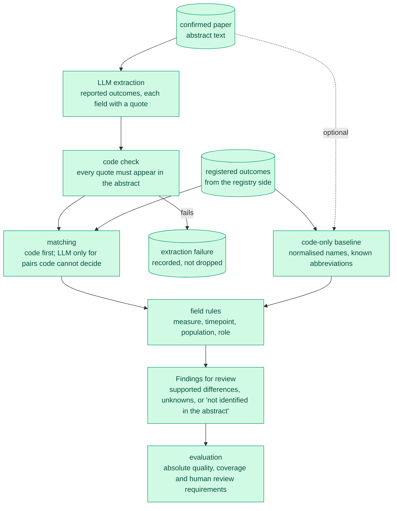

Key points
- The LLM only **reads text** and answers small questions. Code checks the quotes and applies the comparison rules.
- Ambiguous or multiple matches always go to review; the first item is never picked silently.
- Current quality targets are absolute and frozen before evaluation: extraction quality, wrong matches, false reassurance, useful comparison coverage and review routing. Baseline superiority is not a release gate.

**Built and measured (D37-D42).** Per outcome, across all papers read: any paper identified -> identified; else any unclear -> unclear; else unread/failed -> unknown; else not identified. When the optional baseline is enabled, both readers are rolled up and a difference is marked disputed. An absent baseline creates no disagreement. Risky findings are queued first: unclear, disputed, identified in different papers, or identified with no number or test beside the outcome name. A reviewer can also label each link (reports results / protocol / mentions only / not this trial). Final frozen result on 19 trials: LLM found 85% of reported outcomes, baseline 31%; all overclaims reached review.

---

## 3. Safety workflow (question 6: built, evaluated six times, not validated, PARKED since 2026-11-13, D86)

Same shape as 5b, with a safety contract. Built so far: the registry side (parse, store) and a registry-only finding per trial (deaths, serious events, top serious events per group, with evidence; `checks/safety_registry.py`). On the paper side the code baseline reader is built (`compare/safety_baseline.py`: death, serious and named-event sentences with their numbers). The model reader is built too (`compare/safety_llm.py`, run with `read-safety`): one call per abstract, every statement checked by code, the LLM answer and any enabled baseline answer stored separately in `safety_readings` / `safety_statements`. The comparison rules are built as plain code (`compare/safety_compare.py`: definition, group, registry number, population, then the numbers); the roll-up (`compare/safety_rollup.py`) gives one finding per safety quantity per trial (deaths, serious events, each named event) in the report and the review queue. The original safety evaluation (S9) is complete; its limits and the unrun independent v2 holdout are documented in `LLM_IMPROVEMENT_ITERATION.md`.

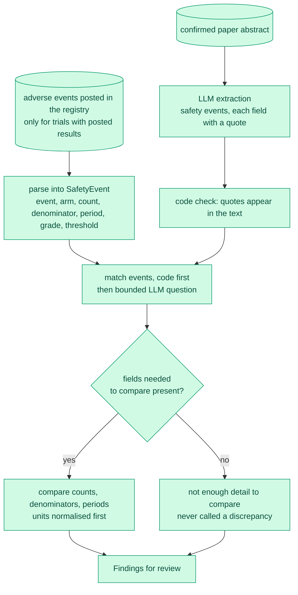

Key points
- A missing denominator, period or grade means "not enough detail to compare", never a discrepancy.
- Different reporting thresholds or periods are not discrepancies by themselves.

---

## 3B. Dashboard workflow (2026-11-13, D85)

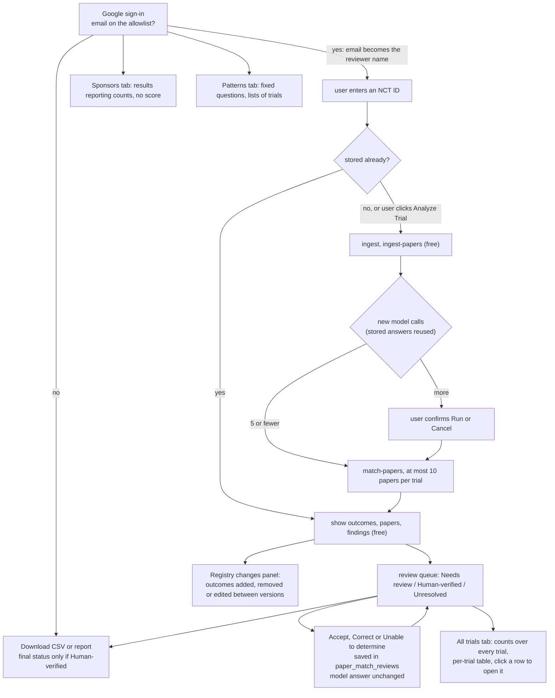

## 3C. Deployment workflow (Docker, CI/CD, and Google Cloud, updated 2026-11-19)

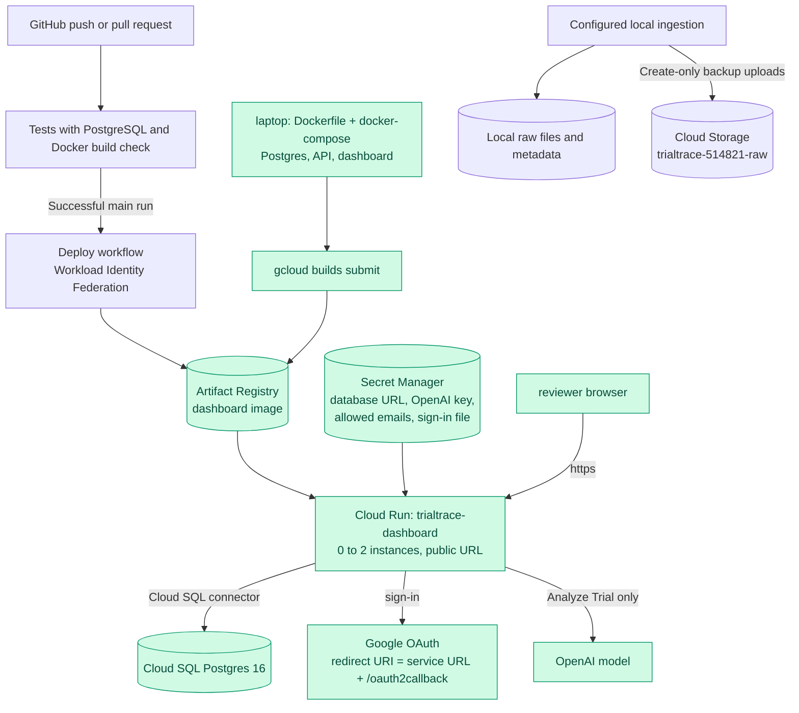

Key points
- The same image runs locally (compose) and on Cloud Run. Cloud Run supplies the port; the start command copies the mounted sign-in file into place.
- The service URL is public, so the app is the gate: Google sign-in plus an email allowlist. With no allowed emails nobody gets in.
- Only the dashboard is deployed. The API is optional and not deployed. After changing a secret, start a new Cloud Run revision.
- Cloud Storage is the deployed raw-source backup. Configured ingestion performs uploads independently of the dashboard runtime. Cloud SQL stores parsed data and evidence. The CI/CD workflow deploys application images; it does not synchronize raw sources or databases.
- Steps and fixes: `DEPLOY_GCP.md`. The full design: `SYSTEM_DESIGN.md`.

## 4. Final combined workflow

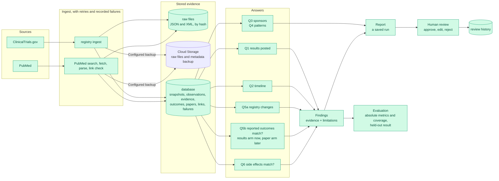

### Which question uses which source

| Question | Source | Method | Status |
|---|---|---|---|
| 1 Results posted? | Registry | Code | Built |
| 2 How long since completion? | Registry | Code | Built |
| 3 Results per sponsor | Registry | SQL | Built |
| 4 Patterns across trials | Registry | SQL | Built |
| 5a Registered outcomes changed? | Registry, two versions | Code | Built |
| 5b (results arm) Posted results match the registered outcomes? | Registry only | Code | Built |
| 5b (paper arm) Paper reports the registered outcomes? | Registry + PubMed | LLM reads, code checks and decides | Built, evaluated on small sets |
| 6 Side effects match? | Registry + PubMed | LLM reads safety statements, code checks and compares | Built; first evaluation done, comparison not validated |

### What a person sees

1. `python -m trialtrace ingest ...` loads trials.
2. `python -m trialtrace ingest-papers` finds and stores their PubMed papers.
3. `python -m trialtrace report` builds a report and saves it as a run.
4. `python -m trialtrace review --reviewer "Name"` records decisions about differences.
5. Nothing learns by itself: reviewer reasons are stored, and a person decides how to improve the rules, which must pass the evaluation first.
